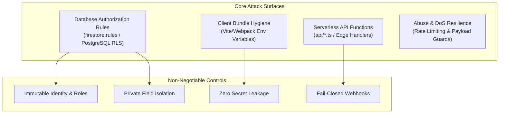

# Cloudflare Security & Code Quality Audit

## Overview

Based on the **Cloudflare Security Audit Standard**, this skill provides an automated audit checklist, heuristic patterns, and verification tests to harden modern web applications against exploitation, privilege escalation, and credential exposure.

## Audit Checkpoints & Threat Matrix



### 1. Database Rule Invariants (`firestore.rules`)
* **Role & Subscription Tampering:** Ensure non-admin users cannot mutate their own `role`, `is_approved`, `has_active_subscription`, or `subscription_status`:
  ```javascript
  match /users/{uid} {
    allow read: if isSelf(uid) || isAdmin();
    allow update: if isAdmin()
      || (isSelf(uid) && unchanged('role') && unchanged('is_approved')
          && unchanged('has_active_subscription') && unchanged('subscription_status'));
  }
  ```
* **Private Subcollection Isolation:** Private investor contact details (email, telegram) must NEVER be exposed in public directory collections. Must require verified unlock checks:
  ```javascript
  match /web3_investors/{id}/private/{doc} {
    allow read: if isAdmin() || (signedIn()
      && get(/databases/$(database)/documents/users/$(request.auth.uid)).data.get('unlocked_investors', []).hasAny([id]));
    allow write: if isAdmin();
  }
  ```
* **Default Deny:** Catch-all must always reject unmatched paths:
  ```javascript
  match /{document=**} { allow read, write: if false; }
  ```

### 2. Serverless API Security (`api/*`)
* **Method Enforcement:** Reject any HTTP method not explicitly supported:
  ```ts
  if (req.method !== 'POST') return res.status(405).json({ error: 'method_not_allowed' });
  ```
* **Payload Size Limits:** Block large payload attacks before parsing JSON:
  ```ts
  export function readBody(req: any, maxBytes = 32_768): any | null {
    if (typeof req.body === 'string' && req.body.length > maxBytes) return null;
    return req.body;
  }
  ```
* **Per-IP Rate Limiting:** Enforce sliding-window in-memory or Redis rate limits (e.g. 10–20 req/min).
* **Fail-Closed Webhooks:** Payment webhooks (e.g. Stripe, Dodo) must verify cryptographic signatures before executing state transitions. If signature verification or admin SDK is not configured, the endpoint must return 501 and grant nothing.

### 3. Secret Isolation (.env)
* **Rule:** Never prefix server-side secret keys (`STRIPE_SECRET_KEY`, `RESEND_API_KEY`, `OPENSIGN_API_KEY`, `FIREBASE_ADMIN_KEY`, `GEMINI_API_KEY`) with `VITE_` or `NEXT_PUBLIC_`.
* **Verification:** Run string analysis on client assets to ensure no API keys or private tokens are embedded in JavaScript chunks.

### 4. Denial of Service & Storage Exhaustion
* **1 MB Document Guard:** Base64-encoded PDF pitch decks or avatars must not exceed Firestore's 1MB document limit. Enforce client-side truncation or cloud storage redirection.
* **Bounded Pagination:** Never perform unbounded queries (`getDocs(collection(...))`). Enforce strict `limit(15)` cursor pagination across all listing feeds.

